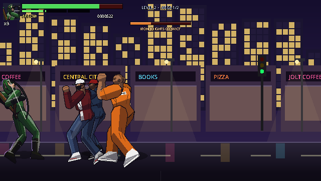
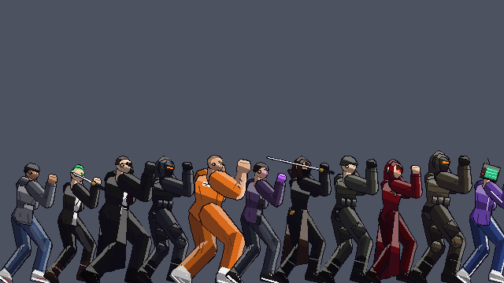

# DC's Arrowverse: Fight Night

A cinematic 2D one-on-one fighting game inspired by the live-action Arrowverse. It's built in **Godot 4.3** and follows the project's game bible (v2.0).

> Personal, noncommercial fan project. DC, the Arrowverse and all related characters are property of DC and their respective owners. This project is not affiliated with or endorsed by them. **All art, sound and music in this repository are original and generated in code.** No sprites, screenshots, logos, soundtrack cues or voice clips are included.


## What's in the build

| Area | Status |
|---|---|
| **Roster** | 14 fighters. Heroes: The Flash, Green Arrow, Supergirl, Black Canary (Laurel Lance), Vibe, Wild Dog, Martian Manhunter, Citizen Steel (**Nate Heywood**). Villains: **Deathstroke**, **Reverse-Flash**, **Reign**, **Vandal Savage**, **Vigilante**. Control Freak is an unlockable boss. |
| **Alternate suits** | Every fighter has 3–4 costumes, 40+ in total. Examples: Flash Season 1 / Season 5 / Jay Garrick tribute; The Hood (S1) and Spectre; Supergirl Season 5 and Overgirl; Black Siren; Reverb; Hank Henshaw; Mirakuru Slade; Harrison Wells; Purity and Pestilence; Hath-Set; Prometheus. |
| **Arenas** | 10 launch stages plus the unlockable boss stage *Freak's Studio*. All have parallax and animated details. |
| **Combat** | Frame-based (60 Hz). Light/medium/heavy attacks, crouching and air attacks, chains, special cancels, block (high/low), throws and throw breaks. Also dashes, 3 specials + 1 super per fighter, projectiles and clashes, armor, invulnerability, counters, teleports, juggles with limits and combo damage scaling. |
| **Fighting systems** | 3-bar super meter. **Amplify** (Block during a special, 1 bar) powers up specials. **Breaker** (Forward + Block while being comboed, 2 bars) escapes combos once per round. **Counter hits** (+20%) and **punishes** (+10%) reward reads. Hard launchers into the corner **wall bounce**. **Quick rise** and **back roll** on wake-up. |
| **Hit feel** | Weighted hitstop, camera zoom punches, screen shake, directional sword-slash sparks, motion smears on strikes, eased animation timing, KO slow-motion, controller vibration. |
| **Modes** | Story (10 chapters across 3 acts plus a Control Freak finale), Arcade (7-fight ladder + ending), Survival, **Beat 'em Up** (1 player or 2-player co-op), Versus (2 players), Versus CPU, Training. |
| **Finishers** | Every fighter has a stylized, hero-appropriate finisher (no gore). After the deciding round the loser staggers and **FINISH IT!** appears. Enter **Back, Forward, Special** within 5 seconds for a cinematic finishing move: Flash's *Speed Force Storm*, Green Arrow's *You Have Failed This City*, Supergirl's *Heat Vision Overdrive*, Vibe's *Breach to Nowhere*, Control Freak's *Cancelled!* and more. CPU winners use them too. You can turn them off in Options. |
| **Tutorial** | 11 interactive lessons (moving, jumping, crouching, attacks, combos, blocking high and low, specials, throws, supers, Amplify). Each lesson shows your actual keys or buttons, and the practice dummy attacks during the blocking lessons. |
| **Pre-fight banter** | Fighters trade lines before round 1. Iconic match-ups have scripted exchanges (Flash vs Reverse-Flash, Green Arrow vs Deathstroke, Supergirl vs Reign...). Press confirm to skip, or turn banter off in Options. |
| **Beat 'em Up** | Side-scrolling brawler with depth lanes. 5 levels (Star City streets, Iron Heights breakout, D.E.O. siege, the Savage future, the Earth-X finale), 2–3 areas each with enemy waves, a Deathstroke mini-boss, and a roster boss at the end of every level (Vigilante, Reverse-Flash, Reign, Vandal Savage, Control Freak). Includes 3 lives per player, continues, pickups (Big Belly Burgers, medkits, Speed Force cells), scoring, a best-score save, and enemies that take turns attacking instead of all piling on. |
| **Enemies** | 11 enemy types with their own AI styles, each in 2–4 variants with different skin tones, hair and outfits: street thugs, knife punks, Bratva enforcers, H.I.V.E. gunners, Iron Heights convicts, rogue metahumans, League assassins, A.R.G.U.S. troopers, Worldkiller cultists, Earth-X soldiers and Control Freak's TV-head minions. |
| **Training** | Dummy modes (stand / crouch / jump / block / CPU), infinite meter, hitbox display, health regen, reset position, frame data readout, combo counter, move list. |
| **CPU** | 5 difficulty levels (default Normal). On Easy and Normal the CPU also hits softer. Story Act I and the first two Arcade fights run one level easier, and every retry after a loss eases the CPU further. It blocks, anti-airs, zones with projectiles, confirms combos, punishes whiffs, amplifies specials, uses Breakers and supers. |
| **Controllers** | Full gamepad support: hot-plug with on-screen notices, automatic assignment, any controller works for Player 1 in single-player modes, button remapping per player, vibration (with strength setting), stick deadzone setting, hold-to-repeat menu navigation, prompts that switch between keyboard and controller (Xbox / PlayStation names), and auto-pause if a player's controller disconnects mid-fight. |
| **Options** | Audio (music / effects / announcer, mute), Video & Accessibility (fullscreen, window scale, crisp integer scaling, screen shake, reduce flashing), Gameplay (difficulty, round timer, rounds to win), Controls (keyboard and controller remapping for both players, swap controllers, vibration, deadzone). Settings persist. |
| **Audio** | All sound effects are synthesized at startup. Music comes from a live step sequencer, with tracks for menu, select, fight (with a variation per stage), survival, boss, story and victory. |





### Character art
Fighters are 158–182 px tall on a 640×360 pixel canvas, so each one is roughly **half the screen height**. That's similar in scale to a classic Mortal Kombat fighter. The canvas is upscaled with nearest-neighbor filtering (2× in a 1280×720 window, 3× at 1080p fullscreen), so pixels stay crisp.

The renderer (`scripts/combat/rig.gd`) draws:
- **Bodies:** each body part is a shaped polygon (tapered, muscled limbs, sculpted male and female torsos, profile heads with eyes, brows and jaw).
- **Shading:** 3-tone banded pixel shading, merged outlines, and a stage-tinted rim light.
- **Costume layers:** cowls with lightning ears, hoods, helmets (Deathstroke's split mask), visors, hockey masks, Martian brow ridges, long and short hair, beards, capes, coat tails, skirts, armor plates, belts with pouches, emblems, and gloves and boots with cuffs.
- **Weapons:** bow and quiver, katana, dagger, pistols.
- **Everyday clothing (beat 'em up enemies):** loose sleeves and trouser legs with creases at the elbows and knees, hoodies (pocket, drawstrings, bunched hood), open jackets, T-shirts with bare tattooed arms, prison jumpsuits, tactical vests with magazine pouches and radios, jeans with seams and worn knees, cargo and track pants, sneakers and boots with soles and laces. Faces get nose and jaw shading, cheekbones, scowling brows, stubble and scars. Enemies stand in a looser, lower street-fighting guard.

## Running the game

1. Install **Godot 4.3** or newer (standard build, not .NET): <https://godotengine.org/download>
2. Clone this repo.
3. Open Godot, click **Import**, and select `project.godot`. The first open imports the project, which takes a few seconds.
4. Press **F5** (Run Project).

You can also run it from a terminal: `godot --path /path/to/dcfightnight`

## Windows, macOS and Linux builds

The game runs on all three. It uses Godot's Compatibility (OpenGL 3.3) renderer, so older GPUs and Macs work too.

**Download a ready-made build:** every push to GitHub runs the workflow in `.github/workflows/build.yml`. It runs the tests, then exports all three platforms. Open the repo's **Actions** tab, click the latest run, and download **FightNight-Windows**, **FightNight-macOS** or **FightNight-Linux** under *Artifacts*.

| Platform | File | First launch |
|---|---|---|
| Windows (64-bit) | `FightNight.exe` | Double-click. Windows SmartScreen may say "Windows protected your PC" because the exe isn't code-signed. Click **More info → Run anyway**. |
| macOS (Intel + Apple Silicon) | `FightNight.zip` → `DC's Arrowverse- Fight Night.app` | Unzip, then **right-click the app → Open → Open**. The app is only ad-hoc signed, so Gatekeeper asks once. If macOS says the app is "damaged", run `xattr -cr "DC's Arrowverse- Fight Night.app"` in Terminal, then open it again. |
| Linux (x86_64) | `FightNight.x86_64` | `chmod +x FightNight.x86_64 && ./FightNight.x86_64` |

**Build it yourself:** install Godot 4.3 and its export templates (**Editor → Manage Export Templates → Download**). Then use **Project → Export** and choose the *Windows Desktop*, *macOS* or *Linux* preset. Or export from a terminal:

```
godot --headless --path . --export-release "Windows Desktop" build/windows/FightNight.exe
godot --headless --path . --export-release "macOS"           build/macos/FightNight.zip
godot --headless --path . --export-release "Linux"           build/linux/FightNight.x86_64
```

All three presets can be exported from any OS. Settings and saves go to the standard per-user folder on each OS (`%APPDATA%\Godot\app_userdata\...` on Windows, `~/Library/Application Support/Godot/app_userdata/...` on macOS, `~/.local/share/godot/app_userdata/...` on Linux).

## Controls

| Action | Player 1 (keyboard) | Player 2 (keyboard) | Gamepad |
|---|---|---|---|
| Move / jump / crouch | W A S D | Arrow keys | D-pad / left stick |
| Light attack | J | Numpad 1 (or `,`) | X |
| Medium attack | K | Numpad 2 (or `.`) | Y |
| Heavy attack | L | Numpad 3 (or `/`) | B |
| Special | U | Numpad 4 (or `;`) | A / RB |
| Block (hold; add Down for a low block). Also Amplify / Breaker | I | Numpad 5 (or `'`) | LB / LT |
| Throw (when close; or Medium + Heavy) | O | Numpad 6 (or `]`) | RT (or Y + B) |
| Pause | Esc / P | Esc / P | Start |

On keyboards without a numpad (laptops, Mac keyboards), Player 2 uses the backup keys shown in brackets.

**Controllers** are detected automatically, including when you plug them in mid-game. In single-player modes (Story, Arcade, Survival, Versus CPU, Training) *any* connected controller controls Player 1. In 2-player Versus and Beat 'em Up Co-op, the first controller is Player 1 and the second is Player 2. You can swap them in **Options → Controls & Controllers**, and remap keyboard keys and controller buttons for each player there too.

**Menus:** D-pad, left stick, arrows or WASD to move (hold to scroll). Confirm with **A** / Enter / J. Go back with **B** / Esc / K. On character select, press **Y** (or U on the keyboard) to cycle through a fighter's suits. The main menu has a **How to Play** page.

### Beat 'em Up controls
Same buttons as versus, with these changes: **Up / Down** walk into and out of the screen (you can only hit enemies in your lane), the **Throw** button jumps, or grabs an enemy if one is right next to you, and **Light + Heavy** together fires your super when the meter is full. Block, Amplify and Breaker work the same as in versus. Clear each area, then follow the **GO** arrow to the right.

### Command list (all fighters)
- **Special:** neutral, toward the opponent, or away from the opponent + Special gives three different special moves.
- **Super:** Down + Special with all 3 meter bars. The meter fills when you deal and take damage.
- **Amplify (1 bar):** press Block during a special's start-up. It does more damage, adds an extra hit and faster projectiles, and gives one hit of armor.
- **Breaker (2 bars):** while being comboed, hold toward the opponent and press Block to knock them away. Once per round.
- **Quick rise / roll:** press any button while knocked down. Hold back to roll away.
- **Dash:** double-tap forward or back. The back-dash briefly avoids attacks.
- **Chains:** Light → Medium → Heavy, and Down+Light → Down+Medium → Down+Heavy (the uppercut launches).
- **Cancels:** a normal attack that hits or is blocked can be cancelled into any special. A special can be cancelled into a super.
- **Blocking:** a standing block stops overheads (all jump-ins). A crouching block stops lows (sweeps, Citizen Steel's shockwave). Specials do a little chip damage.

The full move list with frame data is in [`docs/MOVES.md`](docs/MOVES.md), and in-game under **Pause → Move List**.

## Project structure

```
project.godot
scenes/
  ui/        MainMenu, CharacterSelect, StageSelect, Options, HowToPlay, Credits
  fight/     FightStage, TrainingRoom, Fighter, HUD
  story/     StoryScene
  brawl/     BrawlStage
scripts/
  core/      data.gd (data loader + validation), game.gd (modes, settings, save), input_manager.gd
  combat/    fighter.gd (state machine), rig.gd (procedural pixel-art renderer), poses.gd,
             projectile.gd, effects.gd, cpu_ai.gd
  fight/     fight_stage.gd (round manager, hit resolution, camera, pause, results, training)
  arenas/    arena.gd (all 11 parallax stages)
  ui/        hud.gd, menu_list.gd, portrait.gd and menu screens
  story/     story_scene.gd
  brawl/     brawl_stage.gd (beat 'em up manager: waves, depth lanes, co-op, bosses), brawl_ai.gd, brawl_hud.gd
  audio/     sound_manager.gd (SFX synthesis + music sequencer)
data/
  roster.json, stages.json, story.json
  npcs.json   beat 'em up enemy types (stats, AI style, look and variants)
  brawl.json  beat 'em up levels (areas, waves, mini-bosses, bosses)
  fighters/*.json   one file per fighter: stats, look, alternate costumes, moves, quotes, ending
  moves/base_normals.json   shared normal moves that fighters override
tests/       TestRunner + FlowTest (automated), RenderCheck (art validation), Screenshot (dev helper)
tools/       gen_move_list.py
docs/        MOVES.md, TEST_CHECKLIST.md
```

### Data-driven fighters
Each fighter is one JSON file. Stats, costume colours and every move live there: frame data, hitboxes, projectiles, armor, invulnerability, teleports and counters. You can tune a move without touching any code. Hitboxes use units of the fighter's height, so they scale with the character.

To add a fighter:
1. Copy `data/fighters/vibe.json` and give it a new `id`.
2. Change the `look` (colours, `build`, `head`, `face`, `emblem`, `cape`, `coat`, `skirt`, `plates`, `weapon`, `prop`), the `costumes` (each one overrides fields of `look`; `"none"` removes a field), the `stance` and the `moves`.
3. Add the id to `data/roster.json`.
4. Run the tests. `Data.validate()` catches missing moves, unknown poses and broken references.

Poses are listed in `scripts/combat/poses.gd`. The `pose` field of each move names a wind-up pose and a strike pose.

## Testing

Automated tests run all 14 fighters against each other (196 CPU-vs-CPU matches, every stage, every scene):

```
godot --headless --path . --import          # first time only
godot --headless --path . --fixed-fps 60 res://tests/TestRunner.tscn            # full run (~20 min)
godot --headless --path . --fixed-fps 60 res://tests/TestRunner.tscn -- quick   # 28 matchups (~3 min)
godot --headless --path . --fixed-fps 60 res://tests/FlowTest.tscn              # end-to-end mode flows (~1 min)
godot --headless --path . --fixed-fps 60 res://tests/BrawlTest.tscn             # beat 'em up soak: AI plays all 5 levels solo and co-op
godot --headless --path . --fixed-fps 60 res://tests/BrawlTest.tscn -- quick    # first 2 levels in co-op (~1 min)
godot --headless --path . --fixed-fps 60 res://tests/DifficultyCheck.tscn       # win rates vs Green Arrow at each CPU setting
godot --headless --path . --fixed-fps 60 res://tests/FinisherCheck.tscn         # plays all 14 finishers
godot --headless --path . --fixed-fps 60 res://tests/TutorialCheck.tscn         # completes every tutorial lesson with simulated input
```

`FlowTest` drives every mode through real scene changes by pressing confirm and forcing round results. It covers Story (all chapters, the champion select, unlocks and credits), Arcade (7 fights and the ending), Survival, Versus, Training and Beat 'em Up (level clear, game over and continue). It restores your save file when it finishes.

The runner checks for:
- data validation errors
- broken poses
- fighters leaving the stage bounds or falling below the floor
- invalid health or meter values
- a fighter stuck in one state (softlock)
- runaway combos (infinite-combo guard)
- matches that never finish

It also loads and runs every menu, story and training scene.

`RenderCheck` draws every fighter × costume × pose (rotated, mirrored, with cloth sway) and reports the draw time. Godot prints "Invalid polygon" errors if any shape is broken. It needs a display (or `xvfb-run`):
```
godot --path . --rendering-driver opengl3 res://tests/RenderCheck.tscn
```

To take screenshots for visual review (needs a display, or `xvfb-run` on Linux):
```
godot --path . res://tests/Screenshot.tscn -- /tmp/shots menu select fight:flash:green_arrow:star_labs:400
```

There's a manual checklist in [`docs/TEST_CHECKLIST.md`](docs/TEST_CHECKLIST.md).

## Known limitations
- The art is procedural pixel art drawn from poses, not hand-animated sprite sheets. It's show-inspired, but it can't match the detail of hand-drawn frames. Hand-drawn PNG sprite sheets could later replace the renderer per fighter.
- Villains are playable in Versus, Arcade, Survival and Training (each with an Arcade ending). Story Mode still follows the heroes.
- There are no voice clips. The announcer uses synthesized musical stingers on the Voice bus.
- Online play isn't implemented (a stretch goal in the bible). Local two-player works.
- Two players on one keyboard is cramped. A gamepad for Player 2 is recommended.

## Licensing
- Code: written for this fan project.
- Engine: Godot (MIT). Font: Godot's built-in default font (Open Sans, OFL 1.1).
- Art and audio are generated at runtime by the code in this repo.
- Character names and concepts belong to DC. Keep any public fork free of unlicensed art, audio or video.
