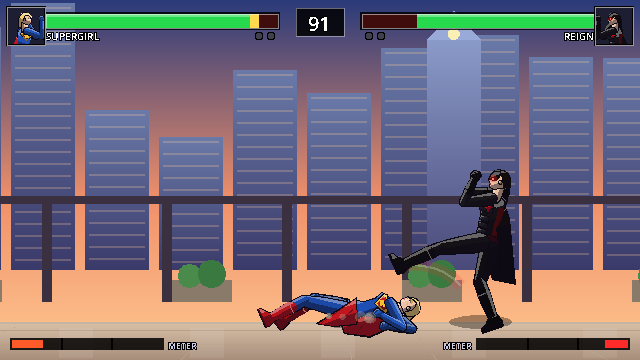

# DC's Arrowverse: Fight Night

A cinematic 2D one-on-one fighting game inspired by the live-action Arrowverse. It's built in **Godot 4.3** and follows the project's game bible (v2.0).

> Personal, noncommercial fan project. DC, the Arrowverse and all related characters are property of DC and their respective owners. This project is not affiliated with or endorsed by them. **All art, sound and music in this repository are original and generated in code.** No sprites, screenshots, logos, soundtrack cues or voice clips are included.



## What's in the build

| Area | Status |
|---|---|
| **Roster** | 8 heroes: The Flash, Green Arrow, Supergirl, Black Canary (Laurel Lance), Vibe, Wild Dog, Martian Manhunter, Citizen Steel (**Nate Heywood**). Control Freak is an unlockable boss. |
| **Arenas** | 10 launch stages plus the unlockable boss stage *Freak's Studio*. All have parallax and animated details. |
| **Combat** | Frame-based (60 Hz). Light/medium/heavy attacks, crouching and air attacks, chains, special cancels, block (high/low), throws and throw breaks. Also dashes, 3 specials + 1 super per fighter, projectiles and clashes, armor, invulnerability, counters, teleports, juggles with limits, combo damage scaling, hitstop, screen shake and hit sparks. |
| **Modes** | Story (10 chapters across 3 acts plus a Control Freak finale), Arcade (7-fight ladder + ending), Survival, Versus (2 players), Versus CPU, Training. |
| **Training** | Dummy modes (stand / crouch / jump / block / CPU), infinite meter, hitbox display, health regen, reset position, frame data readout, combo counter, move list. |
| **CPU** | 5 difficulty levels. It blocks, anti-airs, zones with projectiles, confirms combos and uses supers. |
| **Options** | Volume sliders (music / effects / announcer), mute, fullscreen, window scale, crisp integer scaling, screen shake toggle, reduce flashing, difficulty, round timer, rounds to win, keyboard remapping for both players, and gamepad swap. Settings persist. |
| **Audio** | All sound effects are synthesized at startup. Music comes from a live step sequencer, with tracks for menu, select, fight (with a variation per stage), survival, boss, story and victory. |

### Big, readable sprites
Fighters are 158–182 px tall on a 640×360 pixel canvas, so each one is roughly **half the screen height**. That's similar in scale to a classic Mortal Kombat fighter. The canvas is upscaled with nearest-neighbor filtering (2× in a 1280×720 window, 3× at 1080p fullscreen), so pixels stay crisp.

## Running the game

1. Install **Godot 4.3** or newer (standard build, not .NET): <https://godotengine.org/download>
2. Clone this repo.
3. Open Godot, click **Import**, and select `project.godot`. The first open imports the project, which takes a few seconds.
4. Press **F5** (Run Project).

You can also run it from a terminal: `godot --path /path/to/dcfightnight`

## Windows, macOS and Linux builds

The game runs on all three. It uses Godot's Compatibility (OpenGL 3.3) renderer, so older GPUs and Macs work too.

**Download a ready-made build:** every push to GitHub runs the workflow in `.github/workflows/build.yml`. It runs the tests, then exports all three platforms. Open the repo's **Actions** tab, click the latest run, and download **FightNight-Windows**, **FightNight-macOS** or **FightNight-Linux** under *Artifacts*.

| Platform | File | First launch |
|---|---|---|
| Windows (64-bit) | `FightNight.exe` | Double-click. Windows SmartScreen may say "Windows protected your PC" because the exe isn't code-signed. Click **More info → Run anyway**. |
| macOS (Intel + Apple Silicon) | `FightNight.zip` → `DC's Arrowverse- Fight Night.app` | Unzip, then **right-click the app → Open → Open**. The app is only ad-hoc signed, so Gatekeeper asks once. If macOS says the app is "damaged", run `xattr -cr "DC's Arrowverse- Fight Night.app"` in Terminal, then open it again. |
| Linux (x86_64) | `FightNight.x86_64` | `chmod +x FightNight.x86_64 && ./FightNight.x86_64` |

**Build it yourself:** install Godot 4.3 and its export templates (**Editor → Manage Export Templates → Download**). Then use **Project → Export** and choose the *Windows Desktop*, *macOS* or *Linux* preset. Or export from a terminal:

```
godot --headless --path . --export-release "Windows Desktop" build/windows/FightNight.exe
godot --headless --path . --export-release "macOS"           build/macos/FightNight.zip
godot --headless --path . --export-release "Linux"           build/linux/FightNight.x86_64
```

All three presets can be exported from any OS. Settings and saves go to the standard per-user folder on each OS (`%APPDATA%\Godot\app_userdata\...` on Windows, `~/Library/Application Support/Godot/app_userdata/...` on macOS, `~/.local/share/godot/app_userdata/...` on Linux).

## Controls

| Action | Player 1 (keyboard) | Player 2 (keyboard) | Gamepad |
|---|---|---|---|
| Move / jump / crouch | W A S D | Arrow keys | D-pad / left stick |
| Light attack | J | Numpad 1 (or `,`) | X |
| Medium attack | K | Numpad 2 (or `.`) | Y |
| Heavy attack | L | Numpad 3 (or `/`) | B |
| Special | U | Numpad 4 (or `;`) | A / RB / RT |
| Block (hold; add Down for a low block) | I | Numpad 5 (or `'`) | LB / LT |
| Throw (when close) | K + L | Num2 + Num3 (or `.` + `/`) | Y + B |
| Pause | Esc / P | Esc / P | Start |

On keyboards without a numpad (laptops, Mac keyboards), Player 2 uses the backup keys shown in brackets. Gamepad 1 controls Player 1 and gamepad 2 controls Player 2. You can swap them in Options. Keyboard keys can be remapped in **Options → Player 1/2 Controls**.

**Menus:** move with the arrows or WASD. Confirm with J, Enter or gamepad X. Go back with K, Esc or gamepad Y. On the character select screen, confirm with **Heavy** to pick the alternate costume.

### Command list (all fighters)
- **Special:** neutral, toward the opponent, or away from the opponent + Special gives three different special moves.
- **Super:** Down + Special when the meter is full. The meter fills when you deal and take damage.
- **Dash:** double-tap forward or back. The back-dash briefly avoids attacks.
- **Chains:** Light → Medium → Heavy, and Down+Light → Down+Medium → Down+Heavy (the uppercut launches).
- **Cancels:** a normal attack that hits or is blocked can be cancelled into any special. A special can be cancelled into a super.
- **Blocking:** a standing block stops overheads (all jump-ins). A crouching block stops lows (sweeps, Citizen Steel's shockwave). Specials do a little chip damage.

The full move list with frame data is in [`docs/MOVES.md`](docs/MOVES.md), and in-game under **Pause → Move List**.

## Project structure

```
project.godot
scenes/
  ui/        MainMenu, CharacterSelect, StageSelect, Options, Credits
  fight/     FightStage, TrainingRoom, Fighter, HUD
  story/     StoryScene
scripts/
  core/      data.gd (data loader + validation), game.gd (modes, settings, save), input_manager.gd
  combat/    fighter.gd (state machine), rig.gd (procedural pixel-art renderer), poses.gd,
             projectile.gd, effects.gd, cpu_ai.gd
  fight/     fight_stage.gd (round manager, hit resolution, camera, pause, results, training)
  arenas/    arena.gd (all 11 parallax stages)
  ui/        hud.gd, menu_list.gd, portrait.gd and menu screens
  story/     story_scene.gd
  audio/     sound_manager.gd (SFX synthesis + music sequencer)
data/
  roster.json, stages.json, story.json
  fighters/*.json   one file per fighter: stats, costume colours, moves, quotes, ending
  moves/base_normals.json   shared normal moves that fighters override
tests/       TestRunner (automated), Screenshot (dev helper)
tools/       gen_move_list.py
docs/        MOVES.md, TEST_CHECKLIST.md
```

### Data-driven fighters
Each fighter is one JSON file. Stats, costume colours and every move live there: frame data, hitboxes, projectiles, armor, invulnerability, teleports and counters. You can tune a move without touching any code. Hitboxes use units of the fighter's height, so they scale with the character.

To add a fighter:
1. Copy `data/fighters/vibe.json` and give it a new `id`.
2. Change the `look` (colours, `head`, `face`, `emblem`, `cape`, `prop`) and the `moves`.
3. Add the id to `data/roster.json`.
4. Run the tests. `Data.validate()` catches missing moves, unknown poses and broken references.

Poses are listed in `scripts/combat/poses.gd`. The `pose` field of each move names a wind-up pose and a strike pose.

## Testing

Automated tests run all nine fighters against each other (81 CPU-vs-CPU matches, every stage, every scene):

```
godot --headless --path . --import          # first time only
godot --headless --path . --fixed-fps 60 res://tests/TestRunner.tscn            # full run (~4-5 min)
godot --headless --path . --fixed-fps 60 res://tests/TestRunner.tscn -- quick   # 12 matchups (~40 s)
godot --headless --path . --fixed-fps 60 res://tests/FlowTest.tscn              # end-to-end mode flows (~1 min)
```

`FlowTest` drives every mode through real scene changes by pressing confirm and forcing round results. It covers Story (all chapters, the champion select, unlocks and credits), Arcade (7 fights and the ending), Survival, Versus and Training. It restores your save file when it finishes.

The runner checks for:
- data validation errors
- broken poses
- fighters leaving the stage bounds or falling below the floor
- invalid health or meter values
- a fighter stuck in one state (softlock)
- runaway combos (infinite-combo guard)
- matches that never finish

It also loads and runs every menu, story and training scene.

To take screenshots for visual review (needs a display, or `xvfb-run` on Linux):
```
godot --path . res://tests/Screenshot.tscn -- /tmp/shots menu select fight:flash:green_arrow:star_labs:400
```

There's a manual checklist in [`docs/TEST_CHECKLIST.md`](docs/TEST_CHECKLIST.md).

## Known limitations
- The art is procedural pixel art. Characters are recognizable from silhouette and costume colours, but they aren't hand-animated sprite sheets yet. The renderer (`rig.gd`) is the single place to improve that. Hand-drawn PNG sprite sheets could later replace it per fighter.
- There are no voice clips. The announcer uses synthesized musical stingers on the Voice bus.
- Online play isn't implemented (a stretch goal in the bible). Local two-player works.
- The optional stylized finishers from the bible aren't implemented.
- Two players on one keyboard is cramped. A gamepad for Player 2 is recommended.

## Licensing
- Code: written for this fan project.
- Engine: Godot (MIT). Font: Godot's built-in default font (Open Sans, OFL 1.1).
- Art and audio are generated at runtime by the code in this repo.
- Character names and concepts belong to DC. Keep any public fork free of unlicensed art, audio or video.
